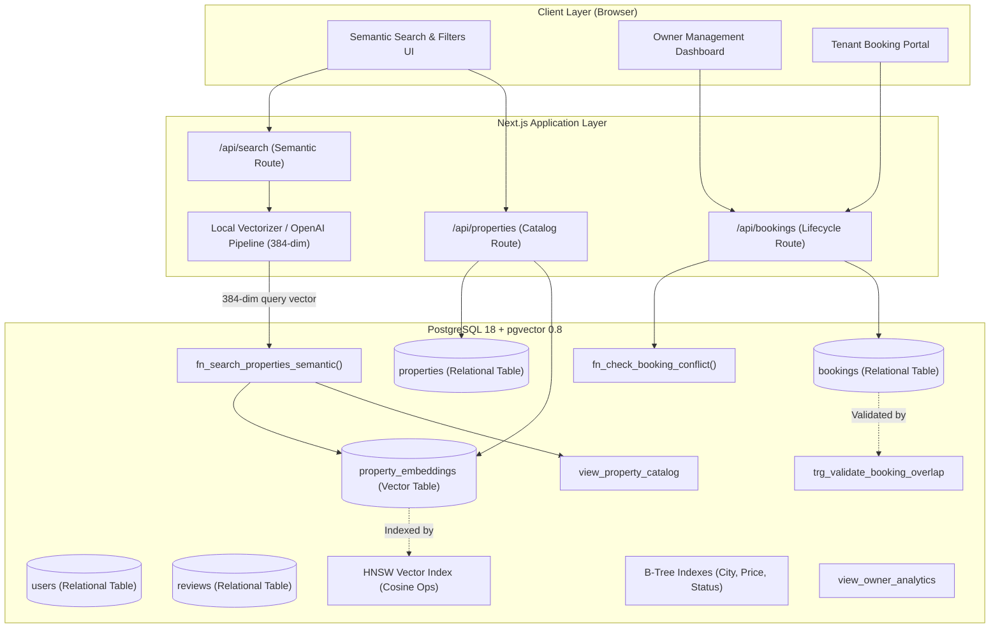
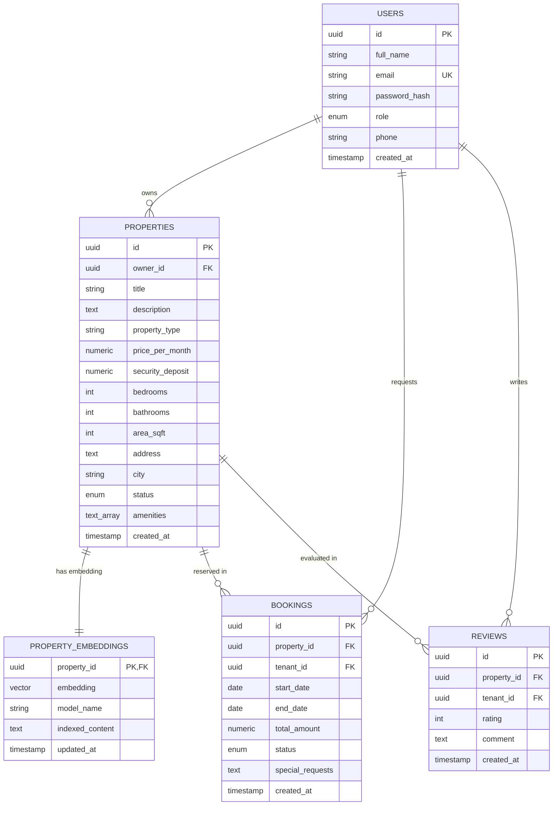

# 📐 PropFind: System Architecture & Database Design

**Project Title:** PropFind: Semantic Property Search & Rental Management System  
**Course:** DBMS Experiential Learning – Level 3 Mini-Project  
**Database Paradigm:** Option 2 (SQL Relational + Vector Database via PostgreSQL & pgvector)

---

## 1. System Architecture Overview

PropFind integrates a Next.js full-stack application with a PostgreSQL database equipped with the `pgvector` extension. The architecture bridges structured relational property management with high-dimensional vector similarity retrieval.



---

## 2. Dual Paradigm Justification (SQL + Vector)

The DBMS Level 3 project guidelines stipulate that database paradigms must be selected based on problem requirements and justified based on data characteristics:

### Why Relational SQL (PostgreSQL)?
- **Relational Integrity**: Entities like Users (Owners & Tenants), Properties, Bookings, and Reviews are intrinsically relational and require strict foreign key constraints (`ON DELETE CASCADE` / `RESTRICT`).
- **ACID Transactions**: Financial transactions (rent, deposits) and reservation scheduling must adhere to strict serializability. Concurrent booking requests must not double-book a rental property.
- **Aggregations & Complex Analytics**: Calculating owner revenue, occupancy rates, and average star ratings demands multi-table `JOIN`, `GROUP BY`, and `HAVING` clauses.

### Why Vector Database (`pgvector`)?
- **Natural Language Discovery**: Traditional keyword search (SQL `LIKE %word%`) fails when a tenant searches for subjective concepts such as *"quiet 2BHK near tech park pet-friendly under 25k"*. A property described as *"peaceful apartment close to Manyata IT hub with open balcony"* would be missed by keyword matching.
- **Unified Engine**: By leveraging `pgvector`, vectors reside in the same database instance as relational records. This eliminates cross-system sync latency, dual-database consistency headaches, and distributed transaction overhead.

---

## 3. Entity-Relationship (ER) Diagram



---

## 4. Vector Embedding & Retrieval Mechanics

1. **Dimensionality**: 384 dimensions (Sentence-Transformers / `all-MiniLM-L6-v2` standard).
2. **Indexing Algorithm**: Hierarchical Navigable Small World (**HNSW**):
   ```sql
   CREATE INDEX idx_property_embeddings_hnsw 
   ON property_embeddings 
   USING hnsw (embedding vector_cosine_ops)
   WITH (m = 16, ef_construction = 64);
   ```
3. **Similarity Operator**: Cosine distance operator `<=>`.
   - Distance ranges from $0$ (identical vectors) to $2$ (diametrically opposite).
   - Similarity score formula: $\text{Similarity} = 1 - (\mathbf{v}_1 \Leftrightarrow \mathbf{v}_2)$.
   - Match percentage displayed in UI: $\text{Match \%} = \text{ROUND}(\text{Similarity} \times 100, 1)$.
